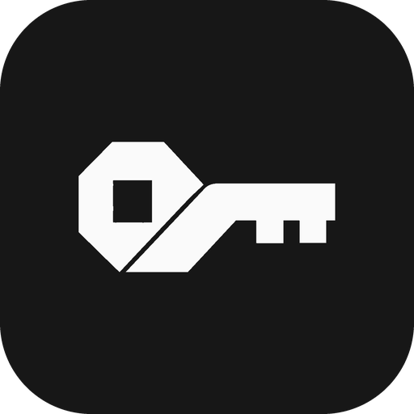
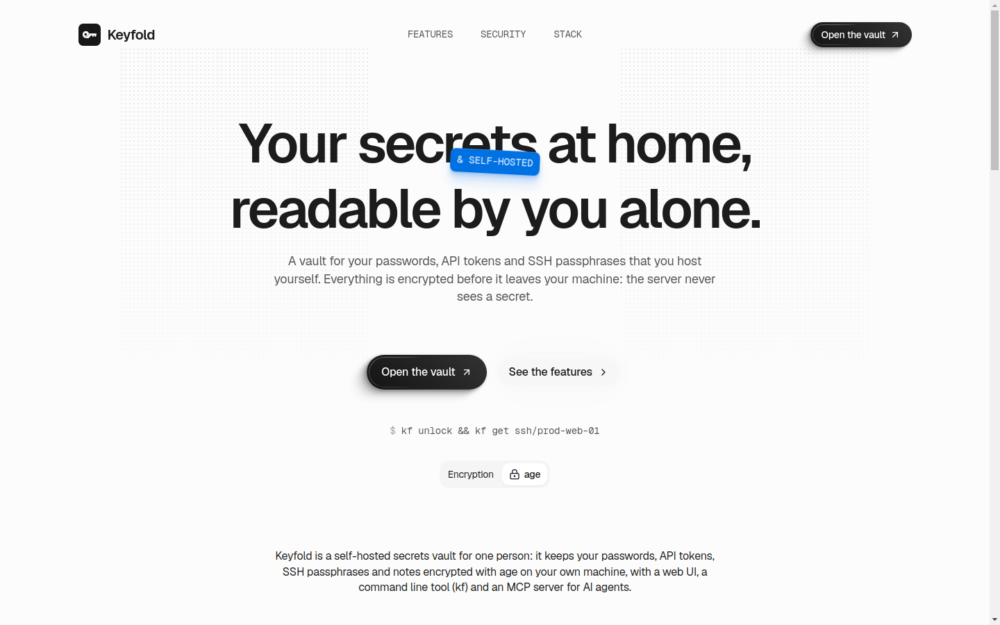
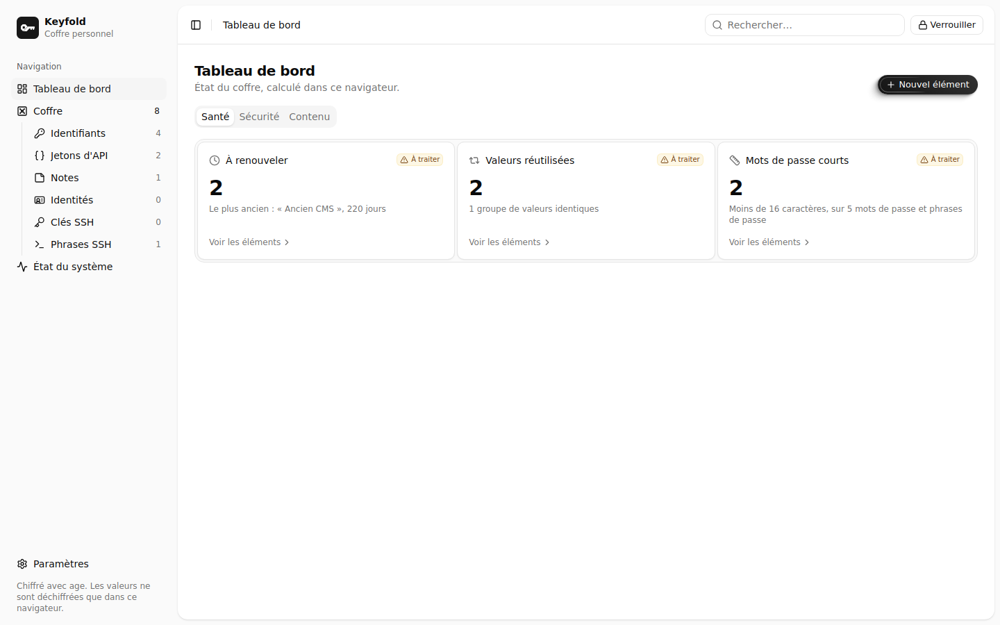
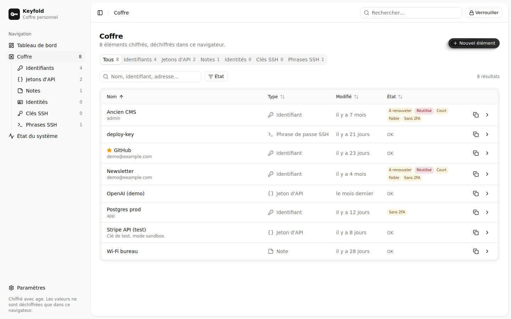
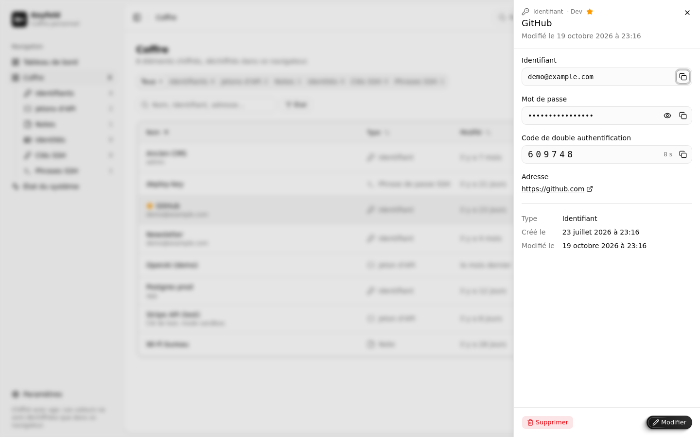
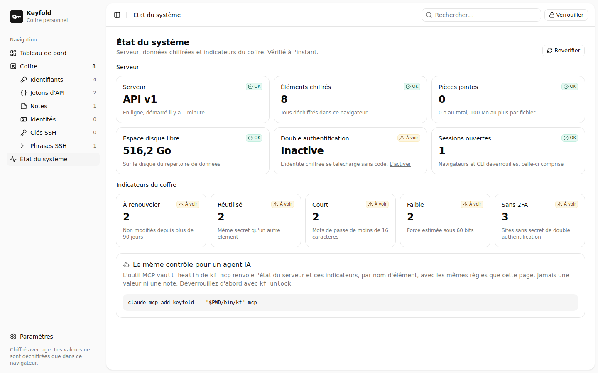

<p align="center">
  
</p>

<h1 align="center">Keyfold</h1>

<p align="center">
  <strong>A self-hosted secrets vault for one person: passwords, API tokens and SSH keys,<br>
  encrypted with <a href="https://age-encryption.org">age</a> before they leave your machine.</strong>
</p>

<p align="center">
  <a href="https://keyfold.pulseview.app">Website</a> ·
  <a href="#cli">CLI</a> ·
  <a href="#mcp-server-for-ai-agents">MCP for AI agents</a> ·
  <a href="#security-model">Security model</a>
</p>

<p align="center">
  
</p>

A Go server stores encrypted files only, a Go CLI (`kf`) hands secrets to
scripts without ever printing them to a terminal, and a React web UI manages
logins, API tokens, notes and SSH keys. An MCP server lets AI agents list and
generate secrets without ever seeing a value. All of them share one vault.
It listens on `127.0.0.1`; your other devices can reach it through a TLS reverse
proxy (`-allowed-hosts`), on a network you trust only (see [Not done](#not-done)).

## Screenshots

| Dashboard | Vault |
|---|---|
|  |  |
| **Item sheet** | **System health** |
|  |  |

The screenshots use a demo vault filled with fake items.

## Features

- **Client-side encryption:** every item is an age file encrypted to an X25519
  identity, itself wrapped with your master password (scrypt). The server never
  sees a value, a name or the master password.
- **CLI for scripts:** `kf read kf://name/field`, `kf run -env VAR=kf://... -- cmd`,
  `kf inject` for config templates, `kf generate`, `kf totp`.
- **Web UI:** full item sheets (identifier, addresses, live TOTP code, custom
  fields, attachments, history), a generator, a health dashboard.
- **AI agents:** `kf mcp` lists items, generates secrets and reports vault
  health, never returning a value.
- **Import and export:** Bitwarden JSON, 1Password 1pux, CSV.
- **Second factor:** optional TOTP before the encrypted identity is handed out.

## Layout

```text
apps/keyfold-server/ vault HTTP server
apps/kf/        CLI and MCP server
apps/web/        React web UI
apps/site/       public product site (Next.js static export, French and English)
packages/vault-core/  TypeScript crypto, API client, statistics, generator,
                      TOTP and breach check, shared by the TypeScript clients
internal/        shared Go packages: vault, store, api, logger, agent,
                 transfer (import and export formats), wordlist
tools/interop/   Go helper for the Go/browser encryption interop test
```

One Go module (`go.mod`) and one Bun workspace (`package.json`, `bun.lock`)
at the root. `make help` lists every command.

## Server

```sh
go run ./apps/keyfold-server                      # listens on 127.0.0.1:8717, data in ./data
go run ./apps/keyfold-server -listen 127.0.0.1:8717 -data ./data -web ./apps/web/dist
```

`-web` serves the built UI as static files when the directory exists.
`-version` prints the build version and commit (if available) and exits.
`-allowed-hosts` (or `KEYFOLD_ALLOWED_HOSTS`) lists the host names accepted
besides loopback ones, comma separated: the names a TLS reverse proxy in front
of the server answers to. Any other `Host` gets 403, for the API and the web UI
alike. The reverse proxy must append the connecting client's IP address to
`X-Forwarded-For`. Keyfold uses the last address in that header only when
the proxy connects over loopback.

`GET /api/v1/alive` gets HTTP 403 from the host guard if `Host` is neither
loopback nor declared. With an allowed `Host`, the probe returns HTTP 404 if
the host or client is not loopback or if the request has a forwarding header.
A direct loopback request to a loopback host with no forwarding headers gets
HTTP 200 with `{"alive":true}`, without a session or a rate limit. The probe
reports only that the server responds and is suitable for a container health
check or a local watchdog.

`make site-build` builds the public product site (`apps/site`: landing pages,
`llms.txt` and `llms-full.txt`, no vault) as static files into `apps/site/out`;
`make site-dev` starts its dev server. That is what keyfold.pulseview.app
serves. For UI
development, `apps/web/vite.config.ts` proxies `/api` to `127.0.0.1:8717`.

`make dev` starts the server and the UI dev server together. `make` alone
lists every target.

Logs go to stdout, one line per request with a `requestId` that is also sent
as the `X-Request-Id` header. They are JSON by default. `KEYFOLD_ENV=development`
(set by `make dev`) prints colored one-line logs, with `NO_COLOR=1` to remove
the colors. Both formats include the method, path, status, duration and client IP
(`client`), plus the matched route when available. Logs omit the query string,
raw headers and body.

On first start with an empty data directory, the server logs a single-use install token once as `installToken`.
Vault creation requires `X-Install-Token` if the connection or host is non-loopback or the request carries a forwarding header.
Direct loopback creation with a loopback host and no forwarding headers needs no token.
Creating the vault clears the token, and restarting before creation logs a new one.

## CLI

```sh
go build -o bin/kf ./apps/kf
```

The server URL comes from `-server`, then `KEYFOLD_SERVER`, then
`http://127.0.0.1:8717`. A URL that is not a loopback address must start with
`https://`: `kf` refuses to send a session token in clear over a network, and
never follows a redirect.

For remote `kf init`, set `KEYFOLD_INSTALL_TOKEN` to the install token from
the server log.

| Command | What it does |
|---|---|
| `kf version` | Prints the build version and commit (if available) without a server or agent. |
| `kf init` | Asks the master password twice (no echo) and creates the vault. |
| `kf unlock [-ttl 1h]` | Asks the master password, decrypts the identity and starts a background agent on `$XDG_RUNTIME_DIR/keyfold/agent.sock` (without that variable, as on macOS: `keyfold-<uid>/agent.sock` in the temp directory). |
| `kf lock` | Stops the agent. |
| `kf get <name>` | Prints the value and a newline to stdout. Refused (exit 1) when stdout is a terminal. |
| `kf set <name> [-kind K] [-note N]` | Reads the value from stdin (no echo on a terminal; one trailing newline is dropped). Kinds: `login` (default), `token`, `note`, `identity`, `ssh-key`, `ssh-passphrase`. An existing item gets the new value and keeps every field no flag sets; the old value goes to its history (20 values kept). |
| `kf read kf://<name>/<field>` | Prints one field, refused on a terminal like `get`. Fields: `value` (or `password`), `username`, `note`, `url` (the first), `totp` (the current code), or a custom field name. Without `/<field>`, the value. |
| `kf run -env VAR=kf://<name>/<field> [-env ...] -- cmd [args]` | Runs `cmd` with the secrets in its environment, never in argv or on disk. Exits with the command's code. |
| `kf inject -i template [-o out]` | Replaces every `{{ kf://name/field }}` of the template. `out` is written `0600`; without `-o`, stdout, refused on a terminal. An unknown reference writes nothing. |
| `kf generate [-len 24] [-symbols=false] [-words N]` | Prints a random password (letters, digits and symbols), or a passphrase of `N` words from the EFF large wordlist. Stores nothing: pipe it into `kf set`. |
| `kf totp <name>` | Prints the item's current TOTP code. |
| `kf export [-format keyfold\|bitwarden-json] [-o file] (-encrypt \| -plaintext)` | Exports every item. `-encrypt` asks a passphrase (16 characters at least) and writes an age file; `-plaintext` must be explicit. Never written to a terminal; `-o` files are `0600`. Attachments are left out (a warning counts them). |
| `kf import -format keyfold\|bitwarden-json\|1password-1pux\|csv <file>` | Adds the items of an export (an `export -encrypt` file asks its passphrase). An item already present is skipped; another one with a taken name gets ` (2)`. Payment cards are skipped and listed. CSV reads the Chrome, Firefox, Bitwarden and 1Password headers. |
| `kf list` | Names and kinds, never values. |
| `kf rm <name>` | Deletes an item and its attachments. |
| `kf migrate [-apply]` | Lists the items stored in an older format; `-apply` rewrites them in the current one. |

An item that cannot be decrypted (a damaged file, or a format this `kf` does
not know) is skipped: a warning on stderr gives its id, and every other item
can still be read, changed and deleted. `list` and `migrate` then exit with
code 3, since they worked on a part of the vault only. Its name is unknown, so
what needs the whole vault is refused until the item can be read again or is
gone: creating an item (`set` on a new name, `import`, the MCP `generate_item`)
and `export`. The web UI lists the readable items, gives the ids on its system
health page and is read-only meanwhile.

Example: start a program with its database password, without a `.env` file:

```sh
kf run -env DB_PASSWORD=kf://prod-db/password -- ./server
```

Example: feed an SSH key passphrase to `ssh-add` through `SSH_ASKPASS`
(`askpass.sh` contains `exec kf get github-key`):

```sh
SSH_ASKPASS=./askpass.sh SSH_ASKPASS_REQUIRE=force ssh-add ~/path/to/key
```

## Web UI

The self-hosted web UI serves the vault. `/` and `/en` redirect to
`/personal/dashboard`. If the vault is locked, it opens `/personal/unlock`
first and returns to the dashboard after unlock. The other vault pages are
`/personal/vault`, `/personal/health` and `/personal/settings`. Legacy paths
such as `/vault` still open under `/personal`.

`/personal/health` is the health check: what the server stores (item and
attachment counts, sizes, free disk space, TOTP, open sessions, from the
authenticated `GET /api/v1/health`, which sees ciphertext only), attachment
files no item lists, and the dashboard indicators of the vault.
The endpoint also reports the server's build version in `version`.

A new vault needs a master password of at least 16 characters, in the web UI
and in `kf init`: the encrypted identity can be downloaded by anyone who
reaches the server, so the master password is the only barrier against an
offline attack.
The creation form asks for the install token on a non-loopback host or when
the server rejects creation because the token is missing or incorrect.

The API is versioned: every route lives under `/api/v1`. `GET /api/v1/items`
returns an `etag` per item; `PUT /api/v1/items/{id}` with `If-Match: <etag>`
answers 412 when the item changed since, so two clients never overwrite each
other in silence.

An item sheet holds an identifier, the secret, web addresses, a TOTP secret
(the current code shows with its countdown), custom fields (hidden or not),
a note, a folder, a favorite flag, attachments and the 20 previous values,
each one restorable. The generator makes 24 character passwords or 6 word EFF
passphrases. A copied secret is cleared from the clipboard after 30 s.

Attachments are encrypted in the browser with age, like items, and stored apart
in `data/blobs/` through `PUT /api/v1/blobs/{id}` (raw age file, streamed, up to
`keyfold-server -max-blob`, 100 MiB by default; other bodies stay under 1 MiB).
Deleting an item deletes its attachments.

The dashboard has three tabs. Santé: items to renew, reused values, short
passwords. Sécurité: weak passwords (estimated entropy under 60 bits), websites
without a TOTP secret, and known breaches through the Have I Been Pwned range
API. That last check is off by default; once allowed in Settings, it runs on
request and sends only the first 5 characters of each password's SHA-1.

Items are JSON in format v2 (`internal/vault/vault.go`, mirrored in
`packages/vault-core/src/item.ts`): v1 items are still read, shown upgraded,
and never written; the web UI shows how many remain until `kf migrate -apply`.

The data directory holds its layout version in `version` (1 today, written by
the first server that serves it): a server refuses a directory written by a
newer layout. One server serves a directory at
a time: a second one on the same directory exits, and a starting server removes
the temp files a killed one left behind.

## Second factor (TOTP)

The server refuses remote downloads of the encrypted vault identity while TOTP
is off. When TOTP is on, downloads require a valid code or a live session. A copy
of the encrypted identity lets someone try master passwords offline. A client
that already holds the decrypted identity, such as the `kf` agent or an unlocked
browser tab, can answer a challenge and start a new session without a code. An
unlocked remote client can turn TOTP off with a valid code.

Open Keyfold directly on the server machine to enable TOTP after creating the
vault or in Settings (`/personal/settings`, bottom of the sidebar), where the
master password can also be changed. TOTP is optional for direct local access.

- With TOTP on, retrieving the encrypted identity requires a valid code or a
  live session.
  Unlocking in the browser and `kf unlock` ask for the code. `kf get`, `set`
  and `kf mcp` do not: they use the agent, already unlocked.
- A code works once across all clients. Five wrong codes in a row lock TOTP
  checks for that client's IP address for 15 minutes.
- Remote clients share a per-IP budget of 60 calls per minute across status,
  init, identity retrieval, challenge and session. Direct requests to a loopback
  host from a loopback connection without forwarding headers are exempt from
  this call limit and have a separate TOTP failure count and lockout. TOTP
  failures expire 15 minutes after the last counted failure. The server tracks
  up to 1,024 remote clients and returns HTTP 429 with `Retry-After` to new
  remote clients while all slots have active limits.
- The secret is stored in clear in `data/totp.json` (0600): the server must read
  it alone. TOTP does not protect a stolen disk.
- Phone lost: on the server machine, `keyfold-server -disable-totp -data ./data`.

Changing the master password re-wraps the same identity: items are not
re-encrypted, and an older copy of the data directory still opens with the old
password.

## MCP server for AI agents

`kf mcp` serves three tools on stdin/stdout. It uses the local agent, so run
`kf unlock` first.

- `list_items`: name, kind, creation and last modification dates.
- `generate_item`: creates an item holding a random secret generated and
  encrypted locally. It refuses a name that already exists.
- `vault_health`: the server facts of `/personal/health` and the dashboard
  indicators (stale, reused, short, weak, website without TOTP) as item names.
  `unreadable` lists the ids of the items that could not be decrypted, as
  `list_items` does.
  The rules are in `internal/vault/health.go`, the same as the web
  (`packages/vault-core/src/stats.ts`): `internal/vault/testdata/health.json`
  holds cases both test suites check.

No tool returns a value or a note, and none edits or deletes: whatever a tool
returns enters the model's conversation and its transcripts.

Register it in Claude Code, from this directory, after `make build`:

```sh
claude mcp add keyfold -- "$PWD/bin/kf" mcp
```

## Security model

- Encryption is client side only, with [age](https://age-encryption.org). The
  vault identity (X25519) is encrypted with the master password (age scrypt
  recipient). Each item, name included, is an age file encrypted to that
  identity. The server never sees the master password, the identity or a value.
- With TOTP off, `GET /api/v1/identity` is available only over a loopback
  connection to a loopback host without forwarding headers. Other requests
  receive HTTP 403, even with a live session. With TOTP on, downloading the
  encrypted identity requires a valid code (header `X-TOTP-Code`) or a live
  session. The download lets someone try master passwords offline. A client
  that already holds the decrypted identity can answer a challenge and start a
  new session without a code. An unlocked remote client can turn TOTP off with a
  valid code.
- API access needs a session token, obtained by decrypting a random challenge
  with the identity. Sessions expire after 15 minutes of inactivity or 12 hours
  from creation, whichever comes first. Tokens and challenges live in server
  memory only, so a server restart locks every client.
- Every response carries a Content-Security-Policy (own files only, plus the
  breach check API; no inline script), `X-Frame-Options: DENY`,
  `X-Content-Type-Options: nosniff` and `Referrer-Policy: no-referrer`. API
  answers are sent with `Cache-Control: no-store`. On a declared host
  (`-allowed-hosts`), `Strict-Transport-Security` is added.
- The CLI agent receives the identity through a pipe, never argv or env, and
  serves it on a `0600` socket in a `0700` directory. It exits after its TTL or
  on `kf lock`. The web UI keeps the identity and token in memory only.

## Not done

- TLS: the server speaks plain HTTP. To reach it from another device, put a TLS
  reverse proxy in front of it and declare its name with `-allowed-hosts`.
- Hardening for an untrusted network: five wrong TOTP codes from anyone lock
  every check. Keep it off the internet.
- Hosting: see [packaging/](packaging/) for the container, reverse proxy and systemd unit.
- Scheduled backups and a copy off the machine: `-backup` below is run by hand.

## Backup and restore

```sh
keyfold-server -data ./data -backup vault.tar     # every file of the vault, attachments included
keyfold-server -data ./new -restore vault.tar     # recreates the directory
```

`-backup` works while the server runs: a file is replaced by a rename, never
written in place, so each archived file is whole. It is not a snapshot of one
instant: an attachment removed while it runs can be missing from the archive,
although the archived item still names it. Stop the server for a backup of one
instant. The archive is a new `0600` file, never written over an existing one;
it gets its name once whole, so a backup that fails or is killed leaves only a
`.partial` file at worst, and can be run again.

`-restore` needs a missing or empty directory: it never writes over a vault. It
refuses an archive cut short, and a failed restore leaves nothing behind.

The archive holds what the data directory holds: items and attachments stay
encrypted with age and it asks no master password, but `totp.json` is in clear
(see [Second factor](#second-factor-totp)). Protect it like the directory itself.

`kf export` is not a backup: it leaves attachments out.

## License

Keyfold is licensed under [AGPL-3.0](LICENSE). If you run a modified Keyfold as
a network service, you must prominently offer the corresponding source code
of your modified version to its users.

See the [security policy](SECURITY.md) and [changelog](CHANGELOG.md).

## Credits

`kf generate -words` and the web generator use the EFF large wordlist by the
Electronic Frontier Foundation (<https://www.eff.org/dice>), under CC BY 3.0 US
(`internal/wordlist/eff_large_wordlist.txt`, copied in
`packages/vault-core/src/wordlist.ts`).

## Tests

```sh
go test ./...
cd packages/vault-core && bun test   # statistics, generator, TOTP, breach check, Go <-> TypeScript age interop
```
