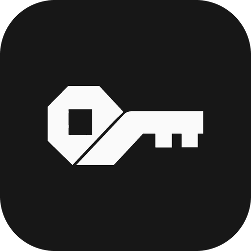
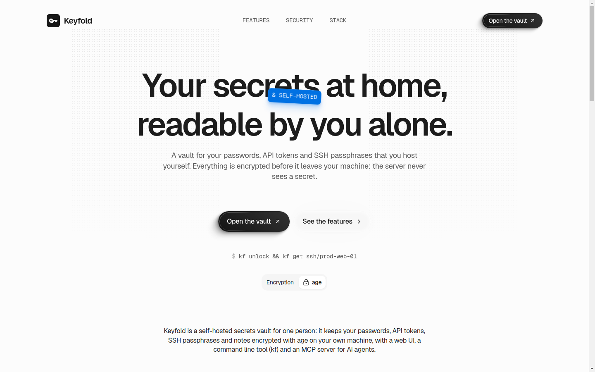
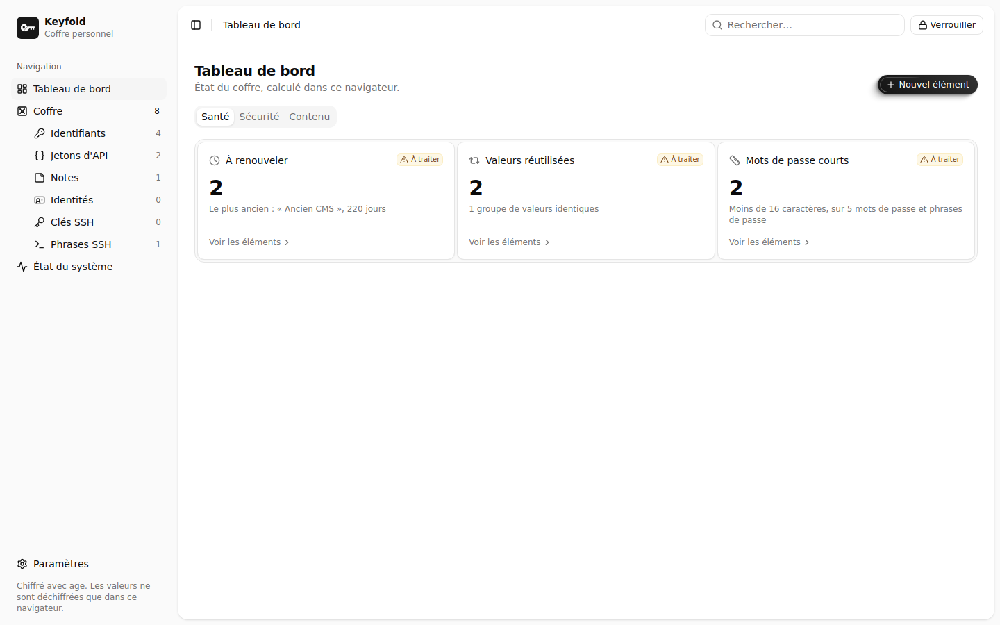
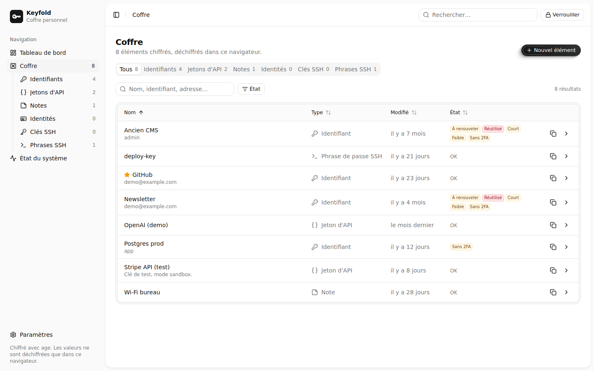
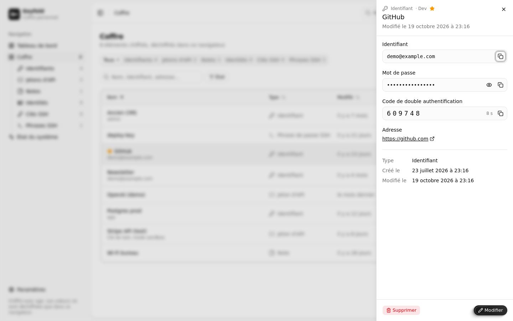
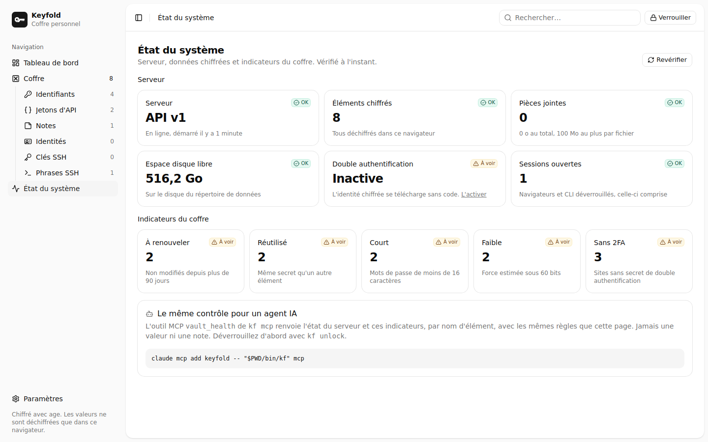

<p align="center">
  
</p>

<h1 align="center">Keyfold</h1>

<p align="center">
  <strong>A self-hosted secrets vault for one person: passwords, API tokens and SSH keys,<br>
  encrypted with <a href="https://age-encryption.org">age</a> before they leave your machine.</strong>
</p>

<p align="center">
  <a href="https://keyfold.pulseview.app">Website</a> ·
  <a href="#cli">CLI</a> ·
  <a href="#mcp-server-for-ai-agents">MCP for AI agents</a> ·
  <a href="#security-model">Security model</a>
</p>

<p align="center">
  
</p>

A Go server stores encrypted files only, a Go CLI (`kf`) hands secrets to
scripts without ever printing them to a terminal, and a React web UI manages
logins, API tokens, notes and SSH keys. An MCP server lets AI agents list and
generate secrets without ever seeing a value. All of them share one vault.
Local use only for now (`127.0.0.1`).

## Screenshots

| Dashboard | Vault |
|---|---|
|  |  |
| **Item sheet** | **System health** |
|  |  |

The screenshots use a demo vault filled with fake items.

## Features

- **Client-side encryption:** every item is an age file encrypted to an X25519
  identity, itself wrapped with your master password (scrypt). The server never
  sees a value, a name or the master password.
- **CLI for scripts:** `kf read kf://name/field`, `kf run -env VAR=kf://... -- cmd`,
  `kf inject` for config templates, `kf generate`, `kf totp`.
- **Web UI:** full item sheets (identifier, addresses, live TOTP code, custom
  fields, attachments, history), a generator, a health dashboard.
- **AI agents:** `kf mcp` lists items, generates secrets and reports vault
  health, never returning a value.
- **Import and export:** Bitwarden JSON, 1Password 1pux, CSV.
- **Second factor:** optional TOTP before the encrypted identity is handed out.

## Layout

```text
apps/keyfold-server/ vault HTTP server
apps/kf/        CLI and MCP server
apps/web/        React web UI
apps/site/       public product site (Next.js static export, French and English)
packages/vault-core/  TypeScript crypto, API client, statistics, generator,
                      TOTP and breach check, shared by the TypeScript clients
internal/        shared Go packages: vault, store, api, logger, agent,
                 transfer (import and export formats), wordlist
tools/interop/   Go helper for the Go/browser encryption interop test
```

One Go module (`go.mod`) and one Bun workspace (`package.json`, `bun.lock`)
at the root. `make help` lists every command.

## Server

```sh
go run ./apps/keyfold-server                      # listens on 127.0.0.1:8717, data in ./data
go run ./apps/keyfold-server -listen 127.0.0.1:8717 -data ./data -web ./apps/web/dist
```

`-web` serves the built UI as static files when the directory exists.
`make site-build` builds the public product site (`apps/site`: landing pages,
`llms.txt` and `llms-full.txt`, no vault) as static files into `apps/site/out`;
`make site-dev` starts its dev server. That is what keyfold.pulseview.app
serves. For UI
development, `apps/web/vite.config.ts` proxies `/api` to `127.0.0.1:8717`.

`make dev` starts the server and the UI dev server together. `make` alone
lists every target.

Logs go to stdout, one line per request with a `requestId` that is also sent
as the `X-Request-Id` header. They are JSON by default. `KEYFOLD_ENV=development`
(set by `make dev`) prints colored one-line logs instead; `NO_COLOR=1` removes
the colors. Only the method, path, status and duration are logged: never a
header, a body or a query string.

## CLI

```sh
go build -o bin/kf ./apps/kf
```

The server URL comes from `-server`, then `KEYFOLD_SERVER`, then
`http://127.0.0.1:8717`.

| Command | What it does |
|---|---|
| `kf init` | Asks the master password twice (no echo) and creates the vault. |
| `kf unlock [-ttl 1h]` | Asks the master password, decrypts the identity and starts a background agent on `$XDG_RUNTIME_DIR/keyfold/agent.sock`. |
| `kf lock` | Stops the agent. |
| `kf get <name>` | Prints the value and a newline to stdout. Refused (exit 1) when stdout is a terminal. |
| `kf set <name> [-kind K] [-note N]` | Reads the value from stdin (no echo on a terminal; one trailing newline is dropped). Kinds: `login` (default), `token`, `note`, `identity`, `ssh-key`, `ssh-passphrase`. An existing item gets the new value and keeps every field no flag sets; the old value goes to its history (20 values kept). |
| `kf read kf://<name>/<field>` | Prints one field, refused on a terminal like `get`. Fields: `value` (or `password`), `username`, `note`, `url` (the first), `totp` (the current code), or a custom field name. Without `/<field>`, the value. |
| `kf run -env VAR=kf://<name>/<field> [-env ...] -- cmd [args]` | Runs `cmd` with the secrets in its environment, never in argv or on disk. Exits with the command's code. |
| `kf inject -i template [-o out]` | Replaces every `{{ kf://name/field }}` of the template. `out` is written `0600`; without `-o`, stdout, refused on a terminal. An unknown reference writes nothing. |
| `kf generate [-len 24] [-symbols=false] [-words N]` | Prints a random password (letters, digits and symbols), or a passphrase of `N` words from the EFF large wordlist. Stores nothing: pipe it into `kf set`. |
| `kf totp <name>` | Prints the item's current TOTP code. |
| `kf export [-format keyfold\|bitwarden-json] [-o file] (-encrypt \| -plaintext)` | Exports every item. `-encrypt` asks a passphrase (16 characters at least) and writes an age file; `-plaintext` must be explicit. Never written to a terminal; `-o` files are `0600`. Attachments are left out (a warning counts them). |
| `kf import -format keyfold\|bitwarden-json\|1password-1pux\|csv <file>` | Adds the items of an export (an `export -encrypt` file asks its passphrase). An item already present is skipped; another one with a taken name gets ` (2)`. Payment cards are skipped and listed. CSV reads the Chrome, Firefox, Bitwarden and 1Password headers. |
| `kf list` | Names and kinds, never values. |
| `kf rm <name>` | Deletes an item and its attachments. |
| `kf migrate [-apply]` | Lists the items stored in an older format; `-apply` rewrites them in the current one. |

Example: start a program with its database password, without a `.env` file:

```sh
kf run -env DB_PASSWORD=kf://prod-db/password -- ./server
```

Example: feed an SSH key passphrase to `ssh-add` through `SSH_ASKPASS`
(`askpass.sh` contains `exec kf get github-key`):

```sh
SSH_ASKPASS=./askpass.sh SSH_ASKPASS_REQUIRE=force ssh-add ~/path/to/key
```

## Web UI

`/` is the public product page (French), `/en` its English version. The vault
app lives under `/personal`: `/personal/unlock`, then `/personal/dashboard`,
`/personal/vault`, `/personal/health` and `/personal/settings`. Any other path
(an old `/vault` bookmark) opens under `/personal`.

`/personal/health` is the health check: what the server stores (item and
attachment counts, sizes, free disk space, TOTP, open sessions, from the
authenticated `GET /api/v1/health`, which sees ciphertext only), attachment
files no item lists, and the dashboard indicators of the vault.

A new vault needs a master password of at least 16 characters, in the web UI
and in `kf init`: the encrypted identity can be downloaded by anyone who
reaches the server, so the master password is the only barrier against an
offline attack.

The API is versioned: every route lives under `/api/v1`. `GET /api/v1/items`
returns an `etag` per item; `PUT /api/v1/items/{id}` with `If-Match: <etag>`
answers 412 when the item changed since, so two clients never overwrite each
other in silence.

An item sheet holds an identifier, the secret, web addresses, a TOTP secret
(the current code shows with its countdown), custom fields (hidden or not),
a note, a folder, a favorite flag, attachments and the 20 previous values,
each one restorable. The generator makes 24 character passwords or 6 word EFF
passphrases. A copied secret is cleared from the clipboard after 30 s.

Attachments are encrypted in the browser with age, like items, and stored apart
in `data/blobs/` through `PUT /api/v1/blobs/{id}` (raw age file, streamed, up to
`keyfold-server -max-blob`, 100 MiB by default; other bodies stay under 1 MiB).
Deleting an item deletes its attachments.

The dashboard has three tabs. Santé: items to renew, reused values, short
passwords. Sécurité: weak passwords (estimated entropy under 60 bits), websites
without a TOTP secret, and known breaches through the Have I Been Pwned range
API. That last check is off by default; once allowed in Settings, it runs on
request and sends only the first 5 characters of each password's SHA-1.

Items are JSON in format v2 (`internal/vault/vault.go`, mirrored in
`packages/vault-core/src/item.ts`): v1 items are still read, shown upgraded,
and never written; the web UI shows how many remain until `kf migrate -apply`.

## Second factor (TOTP)

Optional, offered right after the vault is created and in Settings
(`/personal/settings`, bottom of the sidebar), where the master password can also be
changed.

- With TOTP on, the encrypted identity is only handed out against a code, so
  nobody who merely reaches the server can download it for an offline attack.
  Unlocking in the browser and `kf unlock` ask for the code. `kf get`, `set`
  and `kf mcp` do not: they use the agent, already unlocked.
- A code works once. Five wrong codes in a row lock every check for 15 minutes.
- The secret is stored in clear in `data/totp.json` (0600): the server must read
  it alone. TOTP does not protect a stolen disk.
- Phone lost: on the server machine, `keyfold-server -disable-totp -data ./data`.

Changing the master password re-wraps the same identity: items are not
re-encrypted, and an older copy of the data directory still opens with the old
password.

## MCP server for AI agents

`kf mcp` serves three tools on stdin/stdout. It uses the local agent, so run
`kf unlock` first.

- `list_items`: name, kind, creation and last modification dates.
- `generate_item`: creates an item holding a random secret generated and
  encrypted locally. It refuses a name that already exists.
- `vault_health`: the server facts of `/personal/health` and the dashboard
  indicators (stale, reused, short, weak, website without TOTP) as item names.
  The rules are in `internal/vault/health.go`, the same as the web
  (`packages/vault-core/src/stats.ts`): `internal/vault/testdata/health.json`
  holds cases both test suites check.

No tool returns a value or a note, and none edits or deletes: whatever a tool
returns enters the model's conversation and its transcripts.

Register it in Claude Code, from this directory, after `make build`:

```sh
claude mcp add keyfold -- "$PWD/bin/kf" mcp
```

## Security model

- Encryption is client side only, with [age](https://age-encryption.org). The
  vault identity (X25519) is encrypted with the master password (age scrypt
  recipient). Each item, name included, is an age file encrypted to that
  identity. The server never sees the master password, the identity or a value.
- `GET /api/v1/identity` needs no session: it exposes no more than a stolen disk
  would, and the master password strength is what protects the vault. With TOTP
  on, it needs a valid code (header `X-TOTP-Code`) or a live session.
- API access needs a session token, obtained by decrypting a random challenge
  with the identity. Tokens and challenges live in server memory only (15 min
  idle expiry), so a server restart locks every client.
- The CLI agent receives the identity through a pipe, never argv or env, and
  serves it on a `0600` socket in a `0700` directory. It exits after its TTL or
  on `kf lock`. The web UI keeps the identity and token in memory only.

## Not done

- TLS: the server speaks plain HTTP and must stay on `127.0.0.1`.
- Hosting: no service unit, container or reverse proxy setup.
- Backups of the data directory.

## Credits

`kf generate -words` and the web generator use the EFF large wordlist by the
Electronic Frontier Foundation (<https://www.eff.org/dice>), under CC BY 3.0 US
(`internal/wordlist/eff_large_wordlist.txt`, copied in
`packages/vault-core/src/wordlist.ts`).

## Tests

```sh
go test ./...
cd packages/vault-core && bun test   # statistics, generator, TOTP, breach check, Go <-> TypeScript age interop
```
